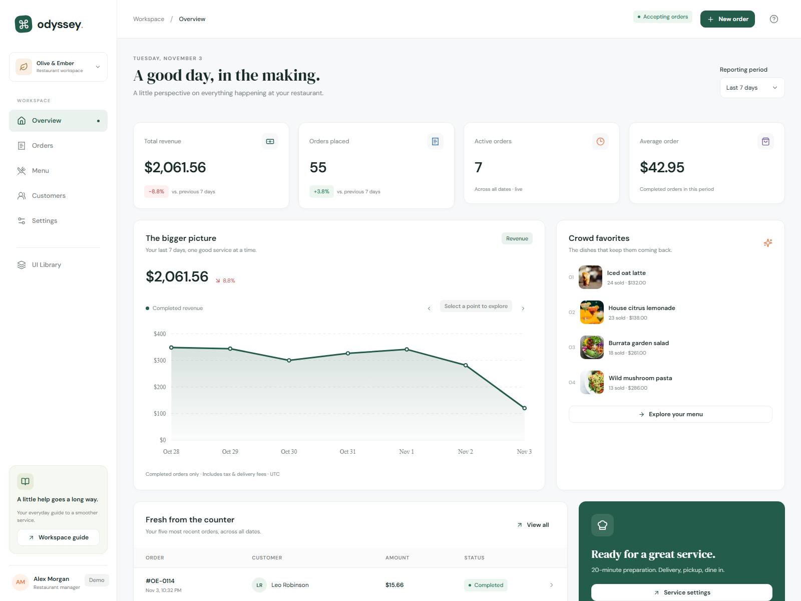
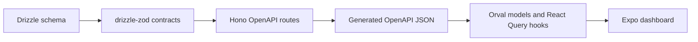

# Odyssey · Olive & Ember

A restaurant operations workspace for the [Odyssey fullstack assignment](<fullstack_developer_assignment_ody(1).md>). Six responsive screens share a small design system and a real PostgreSQL-backed ordering workflow: manage a menu, create an order, move it through the kitchen, and see its completed revenue in CRM and Home.



## Run locally

Prerequisites: **Node.js 22.18+** (verified with 24.6), **pnpm 10.34.9**, and free ports **8081**, **8787**, and **55432**. No Cloudflare account, Docker, or existing PostgreSQL installation is needed for local review.

```sh
npm install --global pnpm@10.34.9
git clone https://github.com/Ghostisme/remote-it-interviews.git
cd remote-it-interviews
pnpm install --frozen-lockfile
pnpm run setup
pnpm dev
```

Open **[the dashboard](http://localhost:8081)**, **[Swagger UI](http://localhost:8787/docs)**, or **[OpenAPI JSON](http://localhost:8787/openapi.json)**. `pnpm dev` starts the Expo web app and the separate Hono Worker together. They can also run in separate terminals:

```sh
pnpm dev:backend
pnpm dev:dashboard
```

`pnpm run setup` creates ignored local environment files, starts a project-owned PostgreSQL 18 cluster, applies committed Drizzle migrations, seeds the restaurant, and regenerates the API client. Use the explicit `run`: `pnpm setup` is pnpm's own shell setup command. The seed contains **4 categories, 12 dishes, 16 customers, and 112 historical orders**, including active kitchen orders. Running setup again preserves existing restaurant data.

Database files stay in `.local/postgres`; the cluster listens only on `127.0.0.1:55432`. Bootstrap verifies the cluster's data directory before creating the dedicated `odyssey` and `odyssey_test` databases. `pnpm db:down` stops this cluster; `pnpm db:up` restarts it. On Windows, an ASCII junction in the system temporary directory allows checkouts with non-ASCII paths. On Unix, run the bundled PostgreSQL tools as a regular user.

For an existing PostgreSQL server, create dedicated databases named `odyssey` and `odyssey_test`, copy `.env.example` to `.env` and `services/backend/.dev.vars.example` to `services/backend/.dev.vars`, and update both connection strings. Then run `pnpm db:migrate`, `pnpm db:seed`, `pnpm gen:contract`, and `pnpm dev` instead of the bundled-cluster setup. Write scripts refuse other database names. The browser defaults to API port 8787; a different API origin can be configured with `EXPO_PUBLIC_API_URL` in `apps/dashboard/.env` before starting Expo.

## Review the product

| Screen | Working behavior |
| --- | --- |
| **Home** `/` | Live revenue and order metrics, previous-period comparison, interactive daily chart, 7/14/30-day reporting, popular dishes, recent order details, service status. |
| **Orders** `/orders` | Search by customer or displayed order number, status/date filters, pagination, customer selection, item quantities, pickup/delivery/dine-in, checkout, pricing breakdown, order details, action buttons and event history. |
| **Menu** `/menu` | Create/rename/reorder categories, delete empty categories, search/filter, create/edit dishes, curated covers, prices/availability, archive/restore and guarded permanent deletion. |
| **CRM** `/crm` | Searchable customer list, pagination, create/edit profiles, notes, order counts, completed spend, recent history and links to individual orders. |
| **Settings** `/settings` | Restaurant profile, accepting orders, auto-accept, service availability, preparation time, minimum order, delivery fee, tax, hours and timezone; validation, save and discard. |
| **UI Library** `/ui-library` | Color/spacing/type/surface tokens, reusable controls, badges, dialogs, tables, skeletons, empty/error/success states and interactive feedback. |

A useful three-minute walkthrough:

1. In **Menu**, add a dish or edit a price. Switch its availability off and see that checkout prevents ordering it; switch it on again.
2. In **CRM**, add a guest and a note. In **Settings**, leave accepting orders enabled and turn auto-accept off to see every kitchen step.
3. In **Orders**, create an order for that guest. Choose dishes and a service; delivery also requires an address. The API returns the authoritative total.
4. Open the order and use **Accept order → Start preparing → Mark ready → Complete order**. The timeline records each action. Cancellation is available only for active orders, asks for confirmation and accepts an optional reason.
5. Open the guest's CRM profile: the completed order contributes to spend. Follow its history entry back to the order. On **Home**, completed revenue and the recent-orders list reflect the same transaction.
6. Set **Accepting orders** off, then try checkout to see the business rule across pages. Restore it afterward.
7. In **Menu → Edit**, archive a dish: it leaves the active menu and new-order picker. Open **Archived** to restore it or permanently delete an unused dish. A dish with past orders remains archived so history stays intact. **Manage categories** supports renaming, display order and deleting empty categories.

Screenshots from the exported web build: [Menu](docs/screenshots/menu.png), [category management](docs/screenshots/categories.png), [Orders](docs/screenshots/orders.png), [order details](docs/screenshots/order-detail.png), [CRM](docs/screenshots/crm.png), [Settings](docs/screenshots/settings.png), [UI Library](docs/screenshots/ui-library.png), [mobile Menu](docs/screenshots/mobile-menu.png), and [mobile Orders](docs/screenshots/mobile-orders.png). Mobile captures use WebKit.

## Architecture

```text
apps/dashboard       Expo 54 / React Native / React Native Web / Expo Router
services/backend     Hono / Cloudflare Workers / PostgreSQL / Drizzle
packages/ui          Shared React Native primitives and design tokens
packages/shared      Pure formatting, currency and validation helpers
packages/types       Re-exports of generated API model types
packages/api-client  Orval-generated React Query hooks/models + Axios transport
tests/e2e            Browser workflows against the real Worker and PostgreSQL
```



Persisted models and enums originate in [`schema.ts`](services/backend/src/db/schema.ts). [`contracts.ts`](services/backend/src/contracts.ts) derives database fields with `drizzle-zod` and adds explicit validation for commands, pagination and aggregate responses. Hono validates these contracts and exposes the same definitions as OpenAPI. `pnpm gen:contract` exports that specification and runs Orval; the spec, generated hooks and models are committed for review. Generated files are regenerated together, never edited by hand.

Screen components compose shared UI and generated hooks. Form/cart logic lives in feature hooks; transactions, pricing, state transitions and analytics live on the backend. React Query manages caching, invalidation and background refresh. Frontend API models come from the generated client or its shared re-export, without a parallel set of handwritten DTOs.

The design system centralizes a warm green/orange palette, DM Sans/DM Serif Display, spacing, radius, borders, elevation and responsive layout rules. React Native primitives cover desktop and narrow web layouts. Web interactions include hover/pressed/disabled states, visible keyboard focus, accessible control labels, dialog focus restoration and nested-dialog Escape handling. Images and fonts ship locally; the running app does not need a photo CDN.

### Ordering rules

- **Money:** prices and totals use integer cents; tax uses basis points. The backend reads current menu prices, rejects duplicate dish IDs, calculates tax once on subtotal, and charges a delivery fee only for delivery. Clients cannot supply authoritative totals. Order lines retain item names and price snapshots after later menu edits.
- **Validation:** unavailable items, paused ordering, disabled services, insufficient subtotal, invalid quantities and missing delivery addresses are rejected. Constraint and validation errors have typed responses and a request ID.
- **State:** `pending → accepted → preparing → ready → completed`. Auto-accept starts at `accepted`. Only active orders can be cancelled. Responses contain allowed actions; commands use row locks and an expected version, so stale actions return a conflict rather than overwriting another operator.
- **Retries:** order creation requires an idempotency key. A transaction-scoped advisory lock serializes retries; an identical request returns the existing order, while the same key with different content returns a conflict.
- **Menu lifecycle:** archiving removes a dish from new ordering without changing historical names, prices or totals. Restoring preserves its previous availability. Permanent deletion requires an archived dish with no order references; a row lock prevents racing a new order. Category edits preserve IDs and dish links; category deletion requires no active or archived dishes.
- **Reporting:** daily Home reporting uses UTC and completed orders; revenue includes their tax and delivery fees. Popular-item revenue counts food lines only. Period metrics compare with the immediately preceding equal-length period; active orders and total customers are all-time counts. CRM spend counts completed orders, and order count excludes cancellations. Order timestamps are displayed in the browser's local time.

## Checks

After `pnpm run setup`:

```sh
pnpm lint
pnpm typecheck
pnpm test
pnpm gen:contract
pnpm build
pnpm exec playwright install chromium webkit
pnpm test:e2e
```

Linux runners may need `pnpm exec playwright install --with-deps chromium webkit`. Playwright starts both servers when needed and reuses running local servers outside CI. The suite runs every scenario in desktop Chromium and mobile WebKit with touch enabled. To review the exported production app, run `pnpm build`, keep the backend running, and use `pnpm preview` instead of the Expo dev server before starting the suite.

| Check | Coverage |
| --- | --- |
| Backend: **12 tests** | Real PostgreSQL transactions, authoritative pricing, snapshots, availability/settings, invalid payloads and malformed JSON, displayed/padded order-number search, valid/conflicting actions, concurrent idempotency, CRM/summary aggregation, menu archiving/restoration, guarded deletion and category edits. |
| Frontend logic: **5 tests** | Cart quantity limits/removal, integer-money parsing, rounded tax/delivery preview, unavailable-item/minimum-spend checks and archived basket items blocking checkout. |
| Browser: **14 checks** | Seven scenarios in each of desktop Chromium and mobile WebKit: complete menu → guest → settings → delivery → kitchen → CRM → revenue workflow; loading/empty/error/retry; nested dialog keyboard/focus; six phone routes; category editing and dish lifecycle; all six loaded pages at seven widths; long content and small-screen dialogs. |
| Responsive layout | Widths **320, 375, 390, 768, 1024, 1366 and 1600 px**, plus **320 × 400** dialog and **1366 × 600** sidebar checks. Controls are checked for clipping, including inside cards; navigation strips and wide tables intentionally scroll. The long-content case uses 80-character unbroken names and a large price. |
| Build | Expo web export and Wrangler Worker deployment bundle in dry-run mode. |

Backend tests migrate and reset only `odyssey_test`. Browser tests use the dedicated `odyssey` review database, remove only records they create, and restore the original settings in a `finally` block. Avoid editing settings manually while the browser suite runs. Traces and screenshots are retained on failure in ignored test output directories.

The implementation was verified locally on Windows with all the checks above. Regenerating the contract leaves the committed generated files unchanged. Screenshots were captured from the exported web app with the real Worker, database, local fonts and images.

## Production build and scope

```sh
pnpm build
# Terminal 1
pnpm dev:backend
# Terminal 2: serve the exported SPA instead of the Expo development server
pnpm preview
```

The preview runs at **[127.0.0.1:8081](http://127.0.0.1:8081)**. Stop the dashboard dev server first because it uses the same port. `apps/dashboard/dist` is a static SPA; a hosting provider must rewrite page routes to `index.html`. The backend build produces `services/backend/dist` through `wrangler deploy --dry-run`. The local preview helper is for review, not a production hosting server.

For a hosted installation, set `EXPO_PUBLIC_API_URL` before building the web app, configure `ALLOWED_ORIGINS` in Wrangler, provide the Worker `DATABASE_URL` secret for a reachable PostgreSQL database, and apply the committed migrations. The Worker uses `nodejs_compat` and the PostgreSQL driver. Deployment to a Cloudflare account and a managed production database was outside this local assessment; the bundle was built, not published.

Scope choices for the assignment's 1–2 day target:

- A single restaurant and USD keep the ordering slice focused. Authentication, roles, payments, dispatch integrations and multitenancy are future production work.
- Opening hours/timezone are editable business information. The explicit accepting-orders switch controls checkout; scheduled closing and holiday exceptions are not implemented.
- Item covers use a local curated gallery rather than an upload/storage service. Photo sources and the asset refresh script are documented in [image credits](apps/dashboard/public/images/README.md).
- Orders refresh by polling and query invalidation. WebSockets and external job queues are unnecessary for this assessment's traffic.
- Web is the verified target, including a touch-enabled mobile WebKit browser context. Physical iPhone/Android devices, WeChat's embedded browser and native app builds were not tested.

## AI-assisted implementation

AI was used for planning, implementation, debugging and review, with the required stack and schema-to-client flow kept as fixed constraints. Review concentrated on generated contract consistency, server-owned money/state rules, transaction behavior, data isolation and reusable UI. Browser checks exposed and helped correct responsive grid widths, controls clipped within cards, React Native Web ARIA state mapping, and nested-dialog focus restoration. Mobile WebKit also exposed a focus race while a nested modal faded in and duplicate Escape handling; web dialogs now activate immediately and handle Escape once for the top dialog. Acceptance relied on real API/database and browser runs, including a completed order whose **$32.10** total appeared in both CRM spend and Home revenue.
